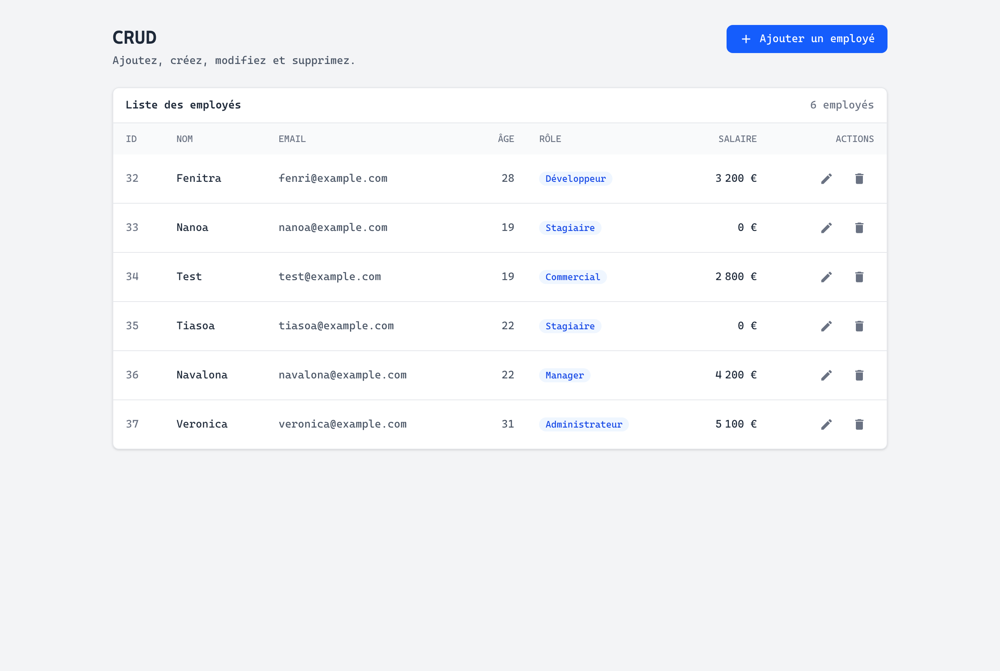
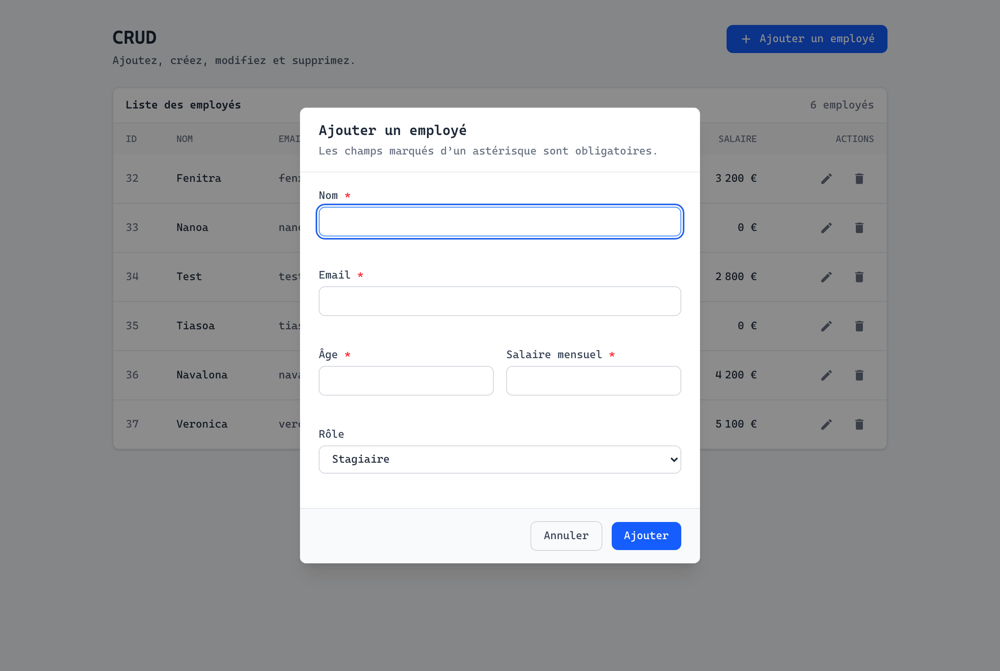
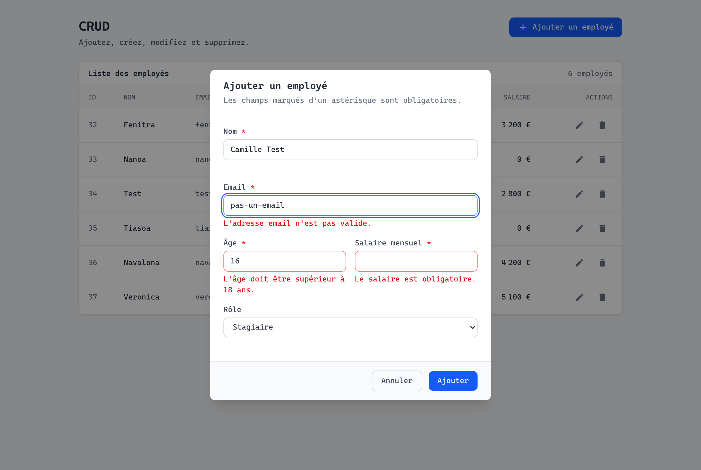
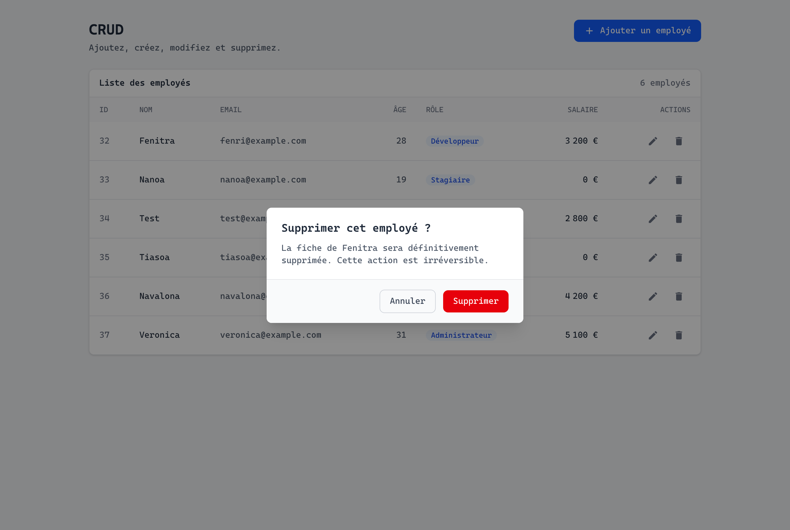
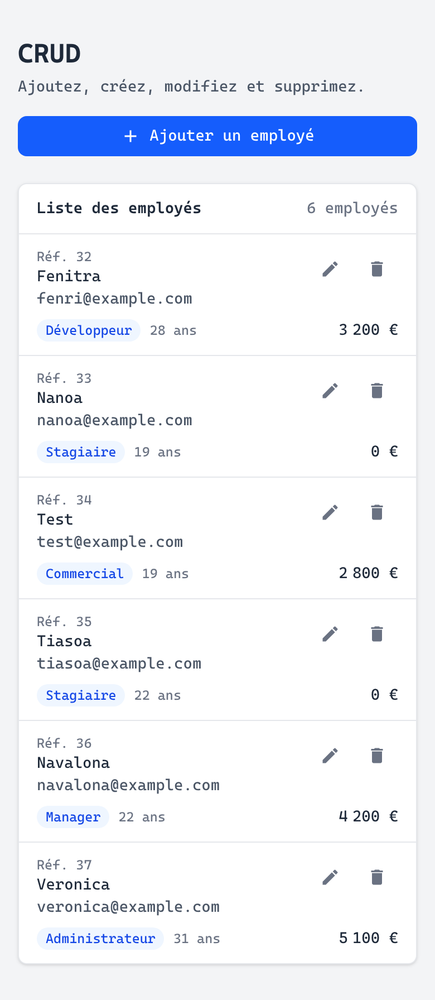

# mon-crud

CRUD complet et entièrement en français : API **Node/Express + PostgreSQL** côté serveur,
**React 19 + Vite + Tailwind 4** côté client.



---

## Aperçu

| Écran | |
|---|---|
| Modale d'ajout |  |
| Validation par champ |  |
| Confirmation de suppression |  |
| Vue mobile (< 640 px) |  |

---

## Fonctionnalités

- **CRUD complet** : créer, lister, modifier, supprimer.
- **Validation double** — serveur (`express`) **et** client (contrôle à la saisie, à la soumission,
  et à la remontée du serveur), avec messages explicites en français.
- **Suppression confirmée** : une fenêtre de confirmation s'ouvre avant tout `DELETE`.
  Aucune ligne n'est effacée sans ce clic.
- **Responsive** : tableau sur desktop, liste de fiches sous 640 px (pas de défilement horizontal).
- **Accessible** : navigation clavier, focus piégé dans les `<dialog>`, `aria-invalid`,
  `aria-describedby`, lien d'évitement, cibles tactiles ≥ 44 px, contraste WCAG AA.

---

## Stack

| Backend | Frontend |
|---|---|
| Node.js + Express 5 | React 19 |
| PostgreSQL via `pg` 8 | Vite 8 + `@vitejs/plugin-react` |
| `dotenv`, `cors` | Tailwind CSS 4 (`@tailwindcss/vite`) |
| Vitest + Supertest | TanStack Query 5, `react-hot-toast`, `react-icons` |

---

## Démarrage

### 1. Base de données

```bash
psql -U postgres -c "CREATE ROLE crud LOGIN PASSWORD 'votre_mot_de_passe';"
psql -U postgres -c "CREATE DATABASE mon_crud OWNER crud;"
```

### 2. Backend

```bash
cd backend
cp .env.example .env        # puis renseigner DB_PASSWORD
npm install
npm run db:init             # applique db/schema.sql (idempotent)
npm run db:seed             # (optionnel) jeu de données de démonstration
npm run dev                 # http://localhost:4000
```

### 3. Frontend

```bash
cd frontend
cp .env.example .env
npm install
npm run dev                 # http://localhost:5173
```

Le front utilise le proxy Vite configuré dans `vite.config.js` : `/api` → `localhost:4000`,
aucune configuration supplémentaire n'est nécessaire en développement.

---

## API

| Méthode | Route | Action |
|---|---|---|
| `GET` | `/api/employee` | liste complète, triée par `id` |
| `GET` | `/api/employee/:id` | détail d'une fiche |
| `POST` | `/api/employee` | création |
| `PUT` | `/api/employee/:id` | modification |
| `DELETE` | `/api/employee/:id` | suppression |

Corps JSON :

```json
{ "name": "Fenitra", "email": "fenri@example.com", "age": 28, "role": "Developer", "salary": 3200 }
```

- `role` est un énuméré PostgreSQL : `Developer | Manager | Sales | Admin | Intern`.
- `email` est stocké en minuscules et contraint en `UNIQUE`.
- Les erreurs renvoient un **code HTTP** + `{ error: { message: "…" } }` en français
  (contraintes `unique_violation`, `check_violation`, `invalid_text_representation`, …).

---

## Structure du projet

```
backend/
  db/
    schema.sql          # tables + énumérations (source unique du schéma)
    seed.sql            # données de démonstration
    init.js             # npm run db:init
    seed.js             # npm run db:seed
  routes/               # employeeRoutes.js
  controllers/          # validation + réponses
  utils/
    connectDB.js        # pool de connexions
    sqlQuery.js         # helpers query / queryOne / execute
    schema.js           # garantit le schéma au démarrage
  tests/                # vitest + supertest (tests d'intégration)
  src/server.js         # app Express + gestion d'erreurs
  DIAGNOSTIC.md         # journal des bugs trouvés et corrigés
  FIXES.md
frontend/
  src/
    App.jsx             # écran CRUD : liste + actions
    api/
      config.js         # URL de base, rôles, libellés
      employeeApi.js    # les 5 requêtes
    components/
      EmployeeTable.jsx # table (≥ 640 px) + liste de fiches (< 640 px)
      EmployeeModal.jsx # modale ajout / modification + validation
      ConfirmDialog.jsx # confirmation de suppression
    utils/
      queryClients.js   # instance unique de QueryClient
      format.js         # formatage des montants et nombres
docs/screenshots/       # captures d'écran du README
```

---

## Tests et vérifications

```bash
cd backend  && npm test          # 10 tests d'intégration (vitest + supertest)
cd frontend && npx eslint .      # lint (0 erreur)
cd frontend && npm run build     # build de production
```

Les tests d'intégration frappent la vraie base PostgreSQL via Supertest
(`NODE_ENV=test vitest run`) : création, validation, contrainte `UNIQUE`,
trouvable par id, inconnu, modification, suppression, et les chemins d'erreur.

---

## Conventions PostgreSQL appliquées

- Placeholders numérotés `$1, $2, …` — jamais `?`.
- `SERIAL` pour l'auto-incrément.
- `DO $$ … $$` pour créer un énumérément de façon idempotente.
- `RETURNING *` pour récupérer l'enregistrement inséré ou modifié.
- `CREATE TABLE IF NOT EXISTS` : `npm run db:init` est sans effet sur une base déjà initialisée.

---

## Journal

Le projet a été durci bug par bug — chaque correction est documentée :

- `backend/DIAGNOSTIC.md` — 12 rappels backend (R1→R12), 8 bugs frontend (F1→F8),
  4 bugs découverts à l'exécution (N1→N4).
- `backend/FIXES.md` — historique détaillé des correctifs.
